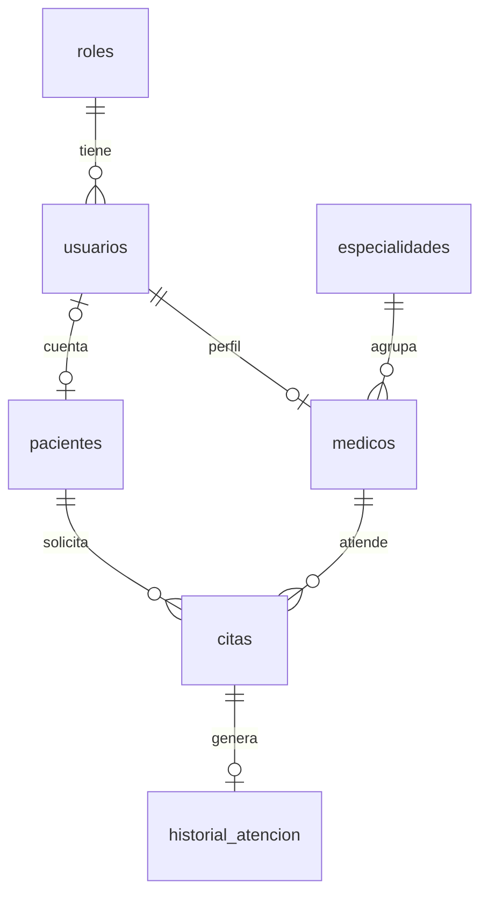

# Sistema de gestión de citas médicas – Análisis y diseño
*(Contenido listo para copiar a Padlet / Trello – Semanas 1 y 2)*

## 1. Problemática
Los pequeños consultorios gestionan pacientes, profesionales y citas de manera manual, dificultando la organización y el seguimiento.

## 2. Objetivos
**General:** desarrollar un sistema web para gestionar pacientes, profesionales, citas e historial de atención.

**Específicos**
1. Registrar y administrar pacientes, médicos y especialidades.
2. Permitir agendar, confirmar, reprogramar y cancelar citas evitando choques de horario.
3. Registrar el diagnóstico y tratamiento de cada atención en un historial consultable.
4. Controlar el acceso mediante login y cuatro roles con permisos diferenciados.
5. Ofrecer un dashboard con indicadores y un reporte de citas exportable.

## 3. Usuarios y actores
| Actor | Qué hace en el sistema |
|---|---|
| Paciente | Se registra, agenda y cancela sus citas, consulta su historial. |
| Médico | Ve su agenda, atiende citas y registra el historial clínico. |
| Recepcionista | Gestiona pacientes y citas (agendar, confirmar, reprogramar, cancelar). |
| Administrador | Gestiona usuarios, médicos y especialidades; ve dashboard y reportes. |

## 4. Historias de usuario (formato Como / Quiero / Para) y prioridad
| # | Historia | Prioridad |
|---|---|---|
| HU1 | Como usuario, quiero iniciar sesión con correo y contraseña, para acceder a las funciones de mi rol. | Alta |
| HU2 | Como paciente, quiero registrarme en el sistema, para poder solicitar mis citas. | Alta |
| HU3 | Como recepcionista, quiero registrar, editar y eliminar pacientes, para mantener su información al día. | Alta |
| HU4 | Como recepcionista, quiero agendar una cita eligiendo paciente, médico, fecha y hora, para organizar la agenda. | Alta |
| HU5 | Como paciente, quiero agendar y cancelar mis propias citas, para no depender de una llamada. | Alta |
| HU6 | Como recepcionista, quiero que el sistema impida dos citas del mismo médico a la misma hora, para evitar choques de agenda. | Alta |
| HU7 | Como médico, quiero ver mis citas y registrar diagnóstico y tratamiento, para mantener el historial del paciente. | Alta |
| HU8 | Como paciente, quiero consultar mi historial de atenciones, para conocer mis diagnósticos y tratamientos. | Media |
| HU9 | Como administrador, quiero crear médicos y asignarles una especialidad, para que puedan recibir citas. | Media |
| HU10 | Como administrador, quiero crear, activar y desactivar usuarios, para controlar quién accede al sistema. | Media |
| HU11 | Como administrador, quiero ver un dashboard con indicadores y gráficos, para tomar decisiones rápidas. | Media |
| HU12 | Como recepcionista, quiero generar un reporte de citas por fechas, médico y estado y exportarlo a CSV, para el seguimiento del consultorio. | Media |
| HU13 | Como recepcionista, quiero confirmar y reprogramar citas, para gestionar cambios de los pacientes. | Baja |
| HU14 | Como administrador, quiero administrar especialidades, para mantener el catálogo actualizado. | Baja |

## 5. Módulos del sistema
Autenticación y roles · Pacientes · Médicos y especialidades · Usuarios · Citas · Historial de atención · Dashboard · Reportes.

## 6. Modelo entidad-relación (7 tablas)

| Tabla | Campos principales | Relaciones / reglas |
|---|---|---|
| roles | id, nombre | 1:N con usuarios |
| usuarios | id, nombre, correo (único), password_hash, rol_id, activo | FK rol |
| especialidades | id, nombre (único) | 1:N con médicos (ON DELETE SET NULL) |
| medicos | id, usuario_id (único), especialidad_id, telefono, registro_profesional | FK usuario (CASCADE) |
| pacientes | id, usuario_id (opcional), documento (único), nombre, correo, telefono, fecha_nacimiento, direccion | FK usuario (SET NULL) |
| citas | id, paciente_id, medico_id, fecha, hora, motivo, estado | N:M paciente–médico con datos propios; paciente CASCADE, médico RESTRICT |
| historial_atencion | id, cita_id (único), diagnostico, tratamiento, observaciones | 1:1 con cita (CASCADE) |

## 7. Arquitectura
Navegador (HTML + Bootstrap + Chart.js) → **Flask** (rutas, validaciones, sesiones, roles) → **MySQL/InnoDB** (XAMPP).
Contraseñas con hash (PBKDF2), consultas parametrizadas (previenen inyección SQL) y decoradores `@login_required(rol)` para el control de acceso.

## 8. Prototipo / flujo de navegación
Login → Dashboard → { Pacientes · Médicos · Especialidades · Usuarios · Citas (agendar → confirmar → atender → historial) · Reportes }.
(El sistema ya funcionando sirve como prototipo; se pueden tomar capturas de cada pantalla para Padlet.)
